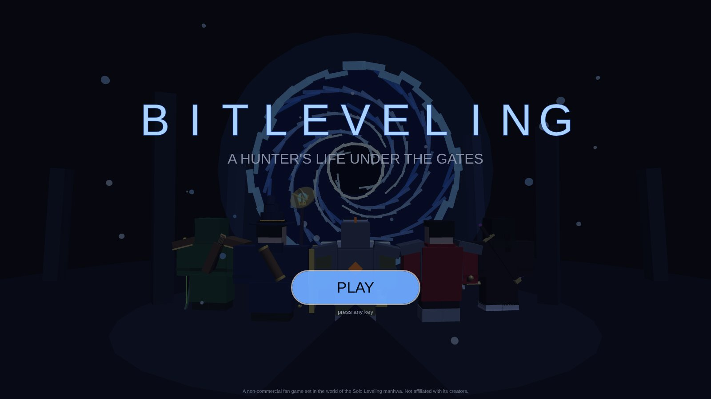
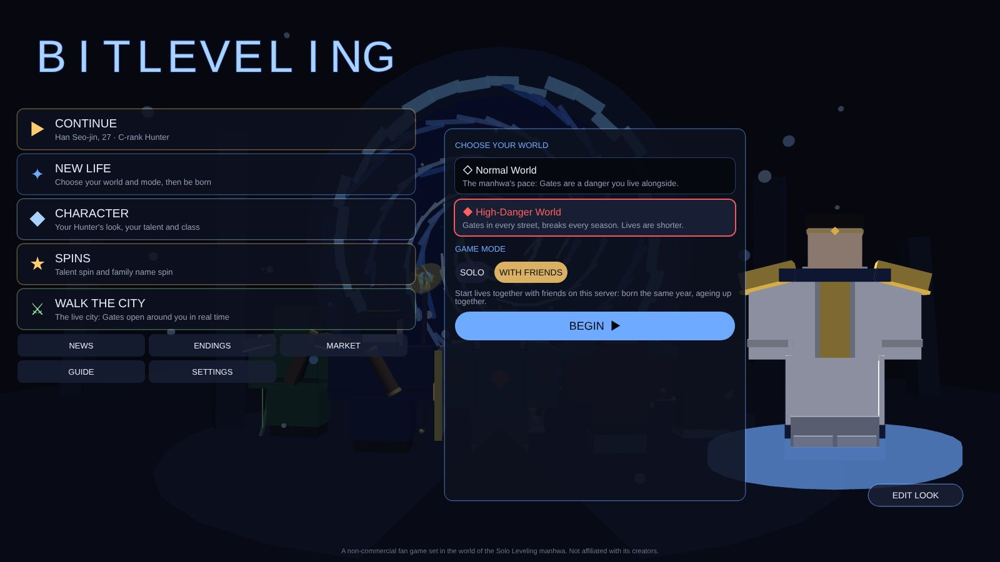

# BitLeveling

A life simulator set in the world of the original **Solo Leveling** manhwa (non-commercial fan
game), built on the LifeSim blueprint kit in this repo. You live one life, year by year: born
before the Gates or under them, maybe awakening, maybe never. You also walk a live 3D city as
your own **R6** character, where Gates open in real time for everyone on the server.

You are never Sung Jinwoo, never the Shadow Monarch's vessel, never chosen. The System is his.
The world has its own story, and it goes on whether you're part of it or not.

- Canon research: [`BITLEVELING_CANON.md`](BITLEVELING_CANON.md). Every fact there has a confidence label, plus a list of popular claims that are **not** canon.
- Studio plugin, Blender pipeline, AI/terminal bridge: [`STUDIO_AND_BLENDER.md`](STUDIO_AND_BLENDER.md)
- Game content: `src/shared/Games/BitLeveling/`
- World simulation: `src/shared/Engine/HunterWorld.luau`
- Live city (server): `src/server/HunterLive/`
- Live city (client): `src/client/HunterLive.luau`, `src/client/UI/HunterBoard.luau`, `src/client/UI/R6Creator.luau`
- R6 rig and looks: `src/shared/Hunter/R6Rig.luau`, `src/shared/Hunter/Looks.luau`

## Canon vs. this game's own

Every lore entry in the in-game Archive is marked **[CANON]** or **[GAME]**.

| Canon (manhwa) | Original game content |
|---|---|
| Gates appear about 10 years before the story; ranks E to S; the Association measures them and sells raid rights | Which Gates open near *your* life, where, when, and what happens to them |
| An uncleared Gate breaks (Dungeon Break); about 7 days is typical, and Tokyo's broke in about 3 | Each Gate's own break clock (a spread around 7 days, shorter in a High-Danger World) |
| Red Gates: turn red once the raid is inside, sealed until the boss dies, readings are wrong | How often they happen, and the odds inside |
| Double Dungeons: extremely rare; the Cartenon Temple is the only canon one | Vanishingly rare, never repeatable anomalies that are **not** the Cartenon Temple and choose no one |
| Rank is fixed at awakening; reawakening is extremely rare | The odds of awakening by age, rank and class weights, and reawakening odds |
| Hunter classes: Fighter, Mage, Assassin, Tanker, Ranger, Healer | Class stat leanings |
| The public timeline: the first Gates, the dragon on the US West Coast and the National Level Hunters, Jeju's fall and the failed raids, Cha Hae-In (9th S-rank), Korea's 10th S-rank, the fourth Jeju raid, the Ahjin Guild, Tokyo's giants, Christopher Reed's death, Go Gunhee's death, the Gate over Seoul, the war, the rewritten world | Your firsthand experience of the parts you're there for (evacuating Jeju, sheltering in Tokyo...) |
| Hunters Association, Surveillance Team, Hunters / White Tiger / Fame / Ahjin guilds, the Hunter Bureau, Scavenger Guild, Draw Sword Guild | The small and mid-size guilds you actually work for, every NPC, every incident |

### How canon and your life coexist

- **Calendar.** Canon gives no calendar years, so years count from the first Gates: *Gate Year 0*. The story begins at Gate Year 10; the other public events sit at their relative years (approximate where canon is: see the brief).
- **News, not cameos.** Canon characters appear the way ordinary people meet them: on the news, when their public events happen. They're never your friends, and never somewhere canon doesn't put them.
- **Secrets stay secret.** The System, the Architect, the Monarchs' plots, what really happened in the Double Dungeon: none of it reaches the news, because nobody in the world could know. (A test checks this.)
- **Firsthand only if you're there.** A life in Jeju when it falls gets the evacuation; a life in Tokyo when the giants come gets that; everyone else reads it. Children never get the dangerous ones.
- **Korea's S-rank count.** Canon says Korea's 10th S-rank was recognised at the story's start, the first since the 9th two years earlier. So a life in Korea can't measure S-rank before Gate Year 11 (it reads A). After that, an S-rank would be Korea's 11th or later.
- **The ending.** Canon ends with time turned back to before the Gates and nobody remembering. When it happens in your life, you choose: **let it happen (canon)**, and your life goes on in a world with no Gates (your years aren't rewound: a simplification, said on the card), or **stay on this world line (non-canon)**, and the game says from then on that you're off the canon story.

## The two worlds

Picked on the start screen (the difficulty picker), for the whole life. They differ in how the
world behaves, not only in numbers:

| | Normal World | High-Danger World |
|---|---|---|
| Gates near you a year | about 6 | about 10, leaning higher-rank |
| Gates opening in streets | fewer | noticeably more (cityShare 0.10 vs 0.24) |
| Break clock | about 4 to 9 days | shorter (instability) |
| Association response | fast, usually enough | slower, stretched, sometimes not enough |
| Share of Gates that break (measured) | about 8% (1% in streets) | about 23% (12% in streets) |
| Red Gates / Double Dungeons | about 0.3% / 0.01% | about 1% / 0.07% |
| Breaks put down before they spread | usually | often not; an S-rank break can take a whole area |
| Wounds, foes | as written | heavier, stronger |
| The live city | a new Gate every few minutes | about twice as often |
| How long lives last (headless) | a careful player: median 75; choosing at random: about 31 | choosing at random: about 22 |

## The world simulation (Engine/HunterWorld.luau)

Every year of a life the world makes its own Gates around it, and runs each through its stages:

1. **Appeared**: a place (the city's own street names), a rank, a kind (ordinary, red, double), an environment and monsters.
2. **Discovered**: at once in a crowded street; days later in a forest; or never, until it breaks.
3. **Response**: the Association measures it (a Red Gate's or Double Dungeon's reading is wrong), and assigns a raid. Higher ranks take longer to field; an S-rank needs the top guilds together.
4. **Active**: the raid goes in. It can fail, and a second team may or may not get there in time.
5. **Resolved or escalated**: cleared, or a **Dungeon Break**: contained, spread, or (S-rank, rarely) an area lost.
6. **Aftermath**: casualties, damage to the city (a damaged city wears on everyone in it, and heals slowly), the news, and your record.

The Association isn't omniscient: response depends on the country's capacity, the city's Hunters,
the world, and how many big incidents it's already handling that year (strain).

**Being there.** A life is only pulled into an incident in its own city, and only when it's
really there: a working Hunter whose rank fits is called to raid it (never more than one rank
above their licence); a break in a busy street might catch you; a Gate might open in front of
you. At most two cards a year (three in High-Danger), most urgent first. Nobody under 13 gets
one, and minors are caught out less (they're in school or at home).

**What you can do depends on who you are.** Civilians get civilian choices (get clear, keep the
crowd moving, film it, call it in; run, shelter, pull someone out). Hunters get their own (hold
the cordon, go in before the Association, fight, hold the line, guide the evacuation, run). The
fight on a card is as strong as the Gate's rank, whoever you are, and the odds preview shows it,
with a warning line when the rank is above yours.

**The news.** Local incidents, the rest of the country, the world, and the canon timeline's public
events. Open **NEWS** on the dock: News, Incidents (what came of each Gate near you, and what you
did), Record (your awakening, raids, breaks, evacuations...), Live.

## The live city (server/HunterLive)

A walkable city built on the server (so everyone shares it): blocks of buildings, roads,
crosswalks, street lamps, a plaza with a news screen, a park, a parking lot, an industrial yard, a
construction site, a subway entrance, a Hunter Association branch and a guild tower. Two dozen
civilians walk its sidewalks.

Every few minutes (about twice as often if anyone on the server is living a High-Danger life),
a Gate opens at one of its sites, running the same engine on a clock:

- the portal opens (blue; there is no colour per rank in canon) and people react, each by temperament: most flee, some freeze, some help others, some shelter in doorways, some stand and film;
- police arrive and tape it off, with light bars and a siren; the Association's van arrives and measures it (the reading goes up on the news screen);
- a raid team walks in. It's cleared and the Gate closes, or it turns **red** and seals (the street goes red around it), or it **breaks**: monsters of its rank come out and chase whoever is nearest, civilians are knocked down (no gore: they fade and are carried off), and the Association sends Hunters to contain it;
- monsters drop **mana crystals** you can collect and sell.

**Walk the city** (dock) puts you in it as your R6 character. Your rank sets your health and speed;
civilians can only run, hide and help. **RESPOND** turns the nearest incident into a card in your
life. **HELP [H]** gets a frozen bystander moving. Hunters can **ATTACK [F / click]**:
- The weapon in your hand swings its own way: a slash, a smash, a thrust, a shot, a throw, a
  spell, a gust, a halo, a punch, a lash or a shield wall.
- It strikes with its element: fire, frost, lightning and so on (`client/WeaponFx`).
- Above that is the **skill bar** (Q E R T G) with a mana bar, and **SKILLS** opens the loadout.

If a monster brings you down, your life takes the injury, and it can kill you.

Admins (and anyone in Studio) get **TEST GATE**, **TEST BREAK** and **TEST RED GATE** buttons on
the dock, which open one at the site nearest them.

## The opening, the title and the menu

**The opening** (`client/OpeningCutscene.luau`, about 52 seconds, Skip ends it) plays when you
join:
- The sky tears open over the city: a Gate in the clouds, lightning, mana falling like meteors.
- A Gate opens in a street at night with a shockwave and glowing cracks, and people run past the
  camera.
- The Association's van brakes in behind the police cordon.
- Six Hunters walk up, each a different class in that class's outfit preset with a weapon, and
  each gets a moment and a class card:
  - Tanker: a shield slam
  - Fighter: a greatsword slash
  - Mage: a magic circle and a fireball
  - Assassin: vanishes in smoke and reappears with afterimages
  - Ranger: an arrow into the sky
  - Healer: a pillar of light
- A High Orc Warlord forces its way out of the Gate, and the party throws it back with a taunt,
  a fireball and a charge.
- They walk in one by one, the camera dives through the whirlpool's tunnel, and BITLEVELING drops
  in letter by letter.

`tests/cutscene_check` plays the whole thing on a fake clock.

**The title** (`client/UI/TitleMenu.luau`) is live 3D: the Gate swirling behind six Hunters in
their class gear, mana drifting, the camera turning. Press PLAY (or any key) to open **the main
menu**:

| Entry | What it does |
|---|---|
| CONTINUE | Back into the life you're living. |
| NEW LIFE | Pick the world (the Normal World at the manhwa's pace, or the High-Danger World with Gates everywhere), solo or with friends, then BEGIN. |
| CHARACTER | Your Hunter's look for the live city, and your life's talent and class leanings. |
| SPINS | The talent spin and the family name spin. |
| WALK THE CITY | Straight into the live city. |
| NEWS, ENDINGS, MARKET, GUIDE, SETTINGS | The rest. |

Your Hunter turns on a podium on the right. The kit's own intro and mode select still work for
packs without the live city (`Config.hunterLive.titleMenu = false` brings them back here too).




**Gates** in the live city are drawn by `client/GateVfx.luau` as canon draws them: a **standing
whirlpool**. It's a vertical disc of spiral arms turning around a dark eye, with a bright rim, an
inner horizon, mana drawn in from around it, and a light. It swirls faster as a break nears,
surges and cracks the street when it breaks, turns red when a raid is sealed in, and collapses
when it closes.

## Weapons, rarities and the market

`Hunter/Weapons.luau` has **202 weapons in 53 families**, graded E to S, each with its own 3D
model (`Hunter/WeaponModels.luau`). The families, by class:
- **Fighter (14):** swords, katanas, odachi, twin swords, greatswords, cleavers, scythes, spears,
  tridents, axes, twin axes, greataxes, warhammers, gauntlets
- **Tanker (9):** shields, bucklers, tower shields, maces, hammers, flails, halberds, glaives,
  lances
- **Assassin (9):** daggers, twin daggers, rapiers, sai, katars, claws, whips, chain-blades,
  kusarigama
- **Ranger (7):** bows, longbows, crossbows, arbalests, javelins, throwing knives, chakrams
- **Mage (8):** staffs, wands, focus orbs, caged crystals, grimoires, floating grimoires, rune
  tablets, war fans
- **Healer (6):** lanterns, thuribles, handbells, rods, scepters, crescent staffs

Each weapon has an **element**: none, fire, frost, lightning, venom, void, holy, wind or earth.
- **On the rig:** the element gives the weapon its glow, its particles and the colour of its
  swing trail.
- **In the live city:** `client/WeaponFx` draws each family's swing (a slash arc, a smash
  shockwave, a thrust streak, a bolt, a thrown kunai or chakram, a rune circle, a gust, a halo, a
  shock ring with claw marks, a lash, a shield wall) and each element's impact (a fireball, ice
  shards, bolts from above, a venom splash, a void implosion, a light pillar, a swirl of wind,
  flying rocks).
- **Names:** every weapon name is the game's own; none is a canon item.

Every weapon that drops is rolled for **stars**: ★ (70%), ★★ (24%, x1.35 power, glowing edges),
★★★ (6%, x1.8, a light of its own). On top of that, 1 in 60 is **Shiny** (x1.45 more, +6% heads
in every fight, gold trim and sparkles). Raids, breaks, Red Gates and Double Dungeons drop them;
harder places drop better ones. A better weapon goes in your hand, the rest to your stash.

**MARKET** on the dock is the Hunters' Market (`server/HunterMarket.luau`): list a weapon for
other players on the server to buy (up to six at once). A listed weapon is held in escrow on your
profile, so nothing is lost if the server closes; a sale made after your life ended waits in your
market wallet for the next one.

## Classes, skills and talents

Every awakened Hunter has a class (canon's six: Fighter, Mage, Assassin, Tanker, Ranger, Healer),
leaned by your stats and birth talents (`Games/BitLeveling/Skills.luau`). Skills are learned on
the DO tab; each needs a rank, enough of its main stat, and the skill before it.
- **Class skills:** each class has **12 skills on two paths**: Fighter Blade and Vanguard, Mage
  Elements and Arcane, Assassin Edge and Night, and so on for the others. That makes 72 in all.
- **Magic schools:** there are **12 schools** of four spells each: fire, frost, lightning, wind,
  earth, water, holy, void, venom, life, arcane and sound.
  - The Mage learns nine of them all the way through, the Healer holy and life, the Assassin
    venom.
  - Once a class has its own third skill, it can learn the first two spells of the schools that
    suit it. A Fighter can learn fire, earth and sound, for example.
- **Hunter craft:** six skills any class can learn: Mana Sensing, Field Medicine, Mana Armour,
  Mana Breathing, Blink, Gate Instinct.
- **Talents:** at birth you get one of **70 talents**, by rarity, from Ordinary to One in the
  World.

**In the live city:** those skills open **251 moves** (`Hunter/Abilities.luau`).
- **Where they come from:**
  - each class's own signature moves
  - 10 or 11 per magic school
  - the physical arts (sword, spear, fist, archery, shield, assassination)
  - Hunter craft
- **Unlocking:** a move unlocks when you learn its skill and reach its rank, E to S. A Hunter
  keeps unlocking new ones for a whole career.
- **Scaling:** every move's damage, mana cost, cast time, reach and heal come from one table by
  rank, so an S-rank move does 3.5 times an E-rank one in the same slot.
- **The skill bar:** five slots.
  - **Q** quick, **E** move, **R** power, **T** guard or support, **G** ultimate.
  - By default each slot takes the best move you have.
  - **SKILLS** (or **K**) opens the loadout: search, filter by class, school, art or craft, and
    see why a locked move is locked.
- **Mana:** your pool grows from 100 at E-rank to 680 at S, plus Intelligence and Willpower, and
  refills over time.
- **Effects:** every move has its own effect (`client/SkillFx.luau`): 81 made by hand, the rest
  composed from 34 shapes (projectiles, novas, beams, meteors, pillars, walls, domes, chains,
  storms, constructs of mana...) in the element's colours.
- **On the server:** every hit is decided there, from your rank, weapon, main stat and buffs.

## Monsters and bosses

The live city's breaks spawn **24 kinds of monster, four a rank** (`server/HunterLive/Monsters.luau`):
goblins, giant rats, cave bats and mana slimes at E; hobgoblins, armoured beetles, giant spiders
and dire wolves at D; orcs, lizardmen, cave trolls and naga at C; ice bears, ogres, wraiths and
iron golems at B; high orc warlords, wyverns, minotaurs and stone golems at A; dragon-kin,
colossi, abyssal serpents and the Hollow King at S. Each is built from parts with jointed limbs
and a gait (biped, four-legged, crawler, spider, flyer, floating, serpent, blob, golem), and
`client/MonsterAnim.luau` animates them on each player's machine: legs by speed, wingbeats,
tails, coils, a swing when they hit. A break brings two kinds. `tools/vfx/monster_sheet.luau`
renders the roster (`docs/images/monsters.png`).

In a life, raids have a **boss room** and Red Gates a throne: **12 bosses fought in turns**
(`Games/BitLeveling/Bosses.luau`, two a rank), with phases, moves telegraphed a turn ahead, and
friends on the server able to join. They're tuned by headless fights: a Hunter at the boss's rank
with middling stats wins about half the time alone, a strong one nearly always; a Red Gate's boss
is a rank above the reading, so run if you must.

## Stories and endings

Beyond the Gate incidents and canon headlines, a life can fall into one of **15 story arcs**
(`Events/Saga_*.luau`, about 130 cards), each running over several years with branches and ways to
fail: founding your own guild (a rival guild, a guild war, a collapse); rising in the Association
(a crime ring that under-reads Gates; Surveillance Team or Branch Director); turning rogue (prison,
testimony, or on the run); the Healer's Oath; the Wall (a Tanker holding a line); four for people
without a rank (a reporter and a buried story, a shelter network, a crystal tycoon, a researcher's
early-warning box); surviving a Red Gate and then a second one; the Hollow Door (a double dungeon
of the game's own, not Cartenon); passing your weapon to a child who awakens.

On the **non-canon world line** (choose to keep the Gates when canon rewrites the world) more open
up, and every card says it's non-canon: **five Monarch paths**, where the power of a Monarch who
died in canon (Rakan, Sillad, Querehsha, Legia, Tarnak) looks for a vessel: take the crown, refuse
it at the last moment, or be consumed; becoming a National Level Hunter; lending your body to a
Ruler; the Association's chair. Ashborn, Antares, Baran and Yogumunt are never offered.

Every life ends in one of **40 fates** (`Games/BitLeveling/Fates.luau`), rarity 1 to 5: the death
screen leads with it, the life's record is titled with it, and your profile collects them (a new
one pays 1 Glow; rare ones make the server's news). The **ENDINGS** tab on the news board lists
the ones you've found and a hint for each one you haven't.

## R6 character customization

`R6 LOOK` on the dock opens the creator (`client/UI/R6Creator.luau`): a lit stage with a
spotlight in your class colour and a dais whose ring glows in your trim colour.
- **Camera:** drag to turn, scroll or pinch to zoom, BODY / FACE / BACK views, and a slow idle
  turn.
- **Bottom bar:** WEAR MY CLASS (your class's preset at your rank), UNDO, RANDOM, SAVE, CLOSE.
- **Dice:** roll a whole outfit for any class, or a civilian's, keeping your face, skin and hair.

The tabs:

- **Presets:** **59** whole outfits on shelves, each card a live preview of you wearing it:
  - every class at E, C, A and S (most at D too)
  - the Association, guilds and civilians
  - five iconic looks of the game's own
- **Body:** 12 skin tones, 3 builds, and an **aura** (mana particles and a light, in one of 9
  colours or your rank's own).
- **Face:** 8 expressions, 8 eye colours, a **mana glow** in the eyes, 6 brows, 15 scars and
  marks, 30 face and neck extras.
- **Head:** 47 Roblox-made hair accessories, 14 dyes, and **33 headwear pieces** (hoods and
  cowls, winged and horned helms, crowns, a mage's hat, a healer's veil...). Helmets and hoods
  cover the hair.
- **Outfit:**
  - **59 tops** in groups (Everyday, Coats, Uniforms, Robes, Combat, Traditional), 9 of them
    robes with skirts and wide sleeves
  - 24 bottoms, 13 shoes and boots, 13 gloves and gauntlets
  - 34 colours for each piece and a trim colour
- **Gear:** 21 armour styles, **30 back items** (capes that swing, quivers, sheaths, shields,
  banners, wings...) and a workshop weapon (69 of them).
- **Accessories:** up to four at once, one per body slot (`Hunter/Accessories.luau`).
  - There are **106**: 15 for each class and 16 for anyone.
  - Each is graded E to S, and a higher grade always gives more.
  - A class's accessories raise that class's main stat.
  - In a life they're **charms** you can buy and wear.

Randomize and Save. The server checks every field.

The rig is built from Parts (the six classic R6 parts, Motor6D joints, the standard attachments),
with the clothes and gear as shells welded to each limb and the face drawn on a plate. Nothing
depends on uploaded meshes or shirt templates that could go missing; the hair is Roblox's own
accessories, loaded by the server with InsertService the first time someone picks one (block
hair stands in if one can't load). Your rank is never picked here: it's what you awaken at.

`tools/avatar/r6_sheet.luau` builds contact sheets on real Roblox instance types (`-- presets`
for presets, headwear, back items and faces; `-- outfits` for every top, bottom, armour, shoe,
glove and accessory; `-- zoom id,id` for chosen presets close up; `-- weapons` for every weapon, `-- weapons fx` for every swing and hit), and
`node tools/gui_render/shoot.js --dump <json> --png <png>` draws them.

**Blender and Studio:** monsters, weapons and gear can wear smooth Blender-made meshes (a mesh
kit modeled by scripts in `tools/blender`). There is also a Studio plugin that installs, previews,
checks and play-tests the game, and a bridge for running Luau in Studio from a terminal or an AI
tool. All three are covered in [`STUDIO_AND_BLENDER.md`](STUDIO_AND_BLENDER.md).

## Testing

```
lune run tools/checkgame BitLeveling            # validate, lint, headless lives
lune run tests/hunterworld_check 100            # the world simulation's behaviour (see below)
lune run tests/fates_check 60                   # every ending reachable, every life ends in one
lune run tests/abilities_check                  # 251 moves: data, scaling, effects, HUD, loadout, real casts on a live server
lune run tests/weapons_check                    # weapons, stars, Shiny, drops, the market's value
lune run tests/weaponfx_check                   # every weapon at every rarity builds; every swing and hit draws
lune run tests/live_build_check                 # the live city, every look option, every monster (built and animated)
lune run tests/live_ui_check                    # the news board, the R6 creator and the market build
lune run tests/outfits_check                    # every outfit option, preset and accessory builds; old saves load
lune run tests/plugin_check                     # the Studio plugin (after bash tools/build_plugin.sh)
python3 tests/bridge_check.py                   # the Studio bridge
tools/blender/run.sh                            # the Blender mesh kit and its previews
lune run tests/compile_check                    # every .luau file parses
lune run tools/avatar/r6_sheet.luau             # R6 looks on real Roblox types (then shoot.js for a PNG)
python3 tests/safety_scan.py src/shared/Games/BitLeveling
bash tools/build_game.sh BitLeveling --no-test  # build/BitLeveling.rbxlx and build/BitLevelingKit.rbxmx
```

`hunterworld_check` checks: every Gate runs through its stages in order and ends; the
High-Danger World breaks more, kills more, answers later and opens more Gates in streets; Red
Gates are rare and Double Dungeons rarer; canon headlines land in their years; no secret canon
reaches the news; Jeju falls, its residents are evacuated, and it's restored after the fourth
raid; Korea has no S-rank before its canon 10th; lives are only pulled into incidents in their
own city; every life saves; raid and Red Gate boss rooms start fights in turns and are recorded
when they end.

What can't be tested here is the live game itself (Roblox Studio isn't available in this
environment): the Roblox-side code is syntax-checked, type-checked against Roblox's API
definitions, and the city, rigs and monsters are built on real Roblox instance types, but the
first real run is in Studio. Open `build/BitLeveling.rbxlx`, press Play, and use the TEST
buttons on the dock.

## Known limits

- The canon brief was gathered from search summaries, not by reading chapters; items marked LIKELY or lower should be checked against the chapter.
- The rewritten world doesn't turn your years back.
- The live city is one shared city: it's "your city" for whoever walks it, whatever their life's city is.
- NPC monsters and Hunters use simple chase-and-strike AI (no pathfinding around buildings).
- The Robux store is off (`fanWork = true`): Solo Leveling is someone else's IP.
- The kit's full-server harness tests (`tests/battle_check` and the others built on
  `tests/harness.luau`) don't boot under this Lune version, on the kit as imported too; the
  engine pieces they cover are tested directly by the checks above.
- The sheet renderer doesn't draw particles, lights or SurfaceGuis on parts, so auras and glows
  are checked structurally and the faces are rendered flat.
