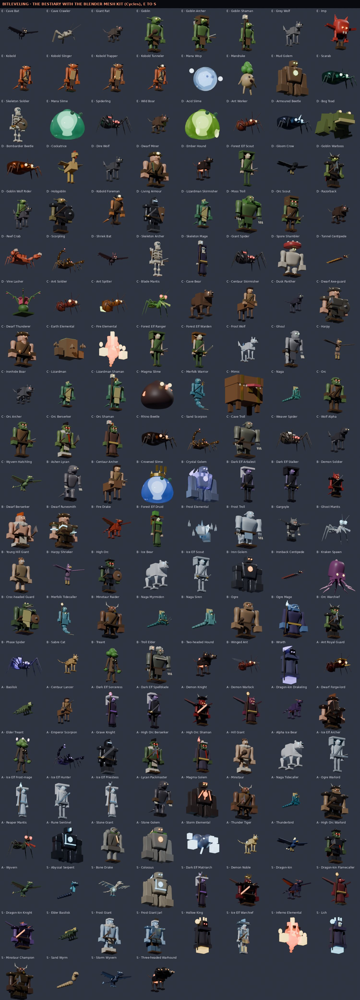
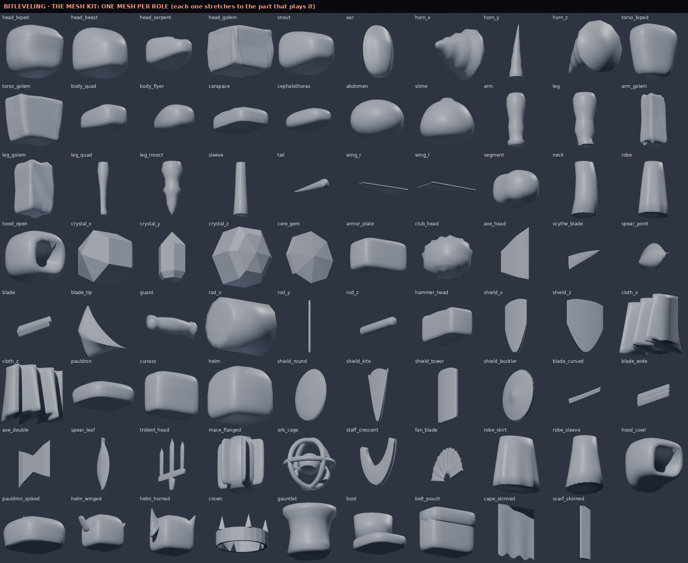
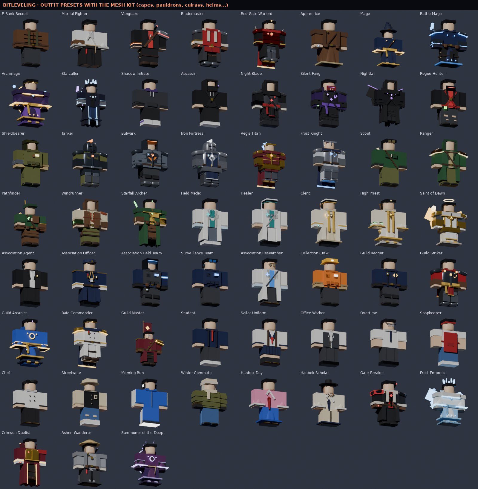
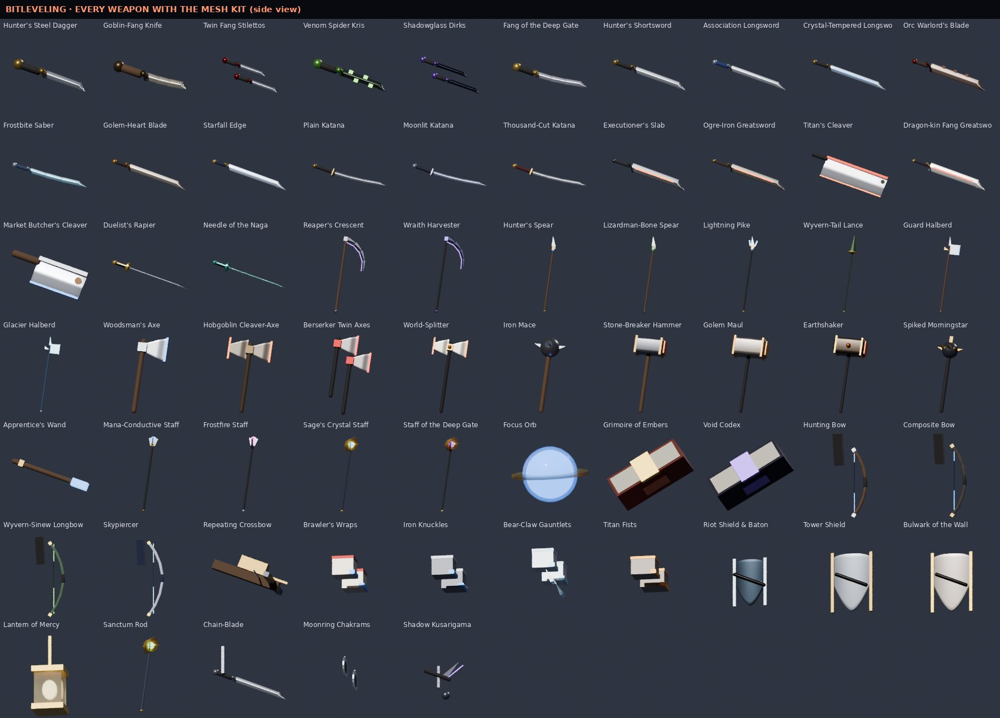
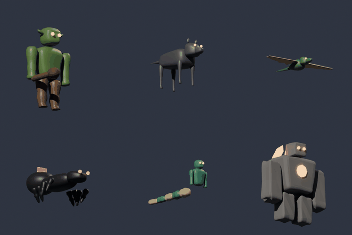

# Studio and Blender: the BitLeveling tools

Three tools for working on BitLeveling outside the code:

- **The BitLeveling Studio plugin**: install the game into any place, preview every monster,
  outfit, weapon and Gate in the editor, check the content, open Gates while play-testing, and
  register the Blender mesh kit.
- **The Blender pipeline**: Blender, driven from scripts, models smooth meshes for the monsters,
  weapons and gear. The game puts them over its part-built models.
- **Connecting an AI or a terminal to Studio**: Studio's own MCP server, or this repo's small
  bridge.



## The Studio plugin

**Build it** (or use the `BitLevelingStudio.rbxmx` you were sent):

```
bash tools/build_plugin.sh        # needs rojo and lune; writes build/BitLevelingStudio.rbxmx
```

**Install it:** in Studio, open the Plugins tab and click **Plugins Folder**. Copy
`BitLevelingStudio.rbxmx` into that folder and restart Studio. The folder is
`%LOCALAPPDATA%\Roblox\Plugins` on Windows and `~/Documents/Roblox/Plugins` on a Mac. A
**BitLeveling** button appears on the Plugins tab and opens the panel.

The panel has these sections:

| Section | What it does |
|---|---|
| **GAME** | **Install / Update game** puts the whole game (the plugin carries a copy) in `ServerScriptService.LifeSimKit` and sets the place up the way the game expects. Press Play and it runs. Updating replaces it. |
| **MESH KIT** | Shows whether the place has the Blender meshes. **Register selected** turns a model imported from `kit.fbx` into the kit, and **Load by id** loads an uploaded one. **Remove kit** goes back to parts. |
| **PREVIEW** | Builds galleries in front of the camera, in `Workspace.BitLevelingPreview`, with the mesh kit if the place has it. **Monsters**: every kind, by rank. **Outfits**: all 59 presets, a row per shelf. **Weapons**: all 202, a row per family, grouped by class, with star ratings, Shiny ones and their elements. **Accessories**: all 106, a row per class. **Gates**: every rank and a Red Gate, swirling. **Clear previews** removes them. |
| **CHECKS** | **Validate content** checks every card, id and reference. **Simulate 20 lives** runs headless lives and reports median age, awakenings, fates and crashes. Both run on the game installed in the place, so an edit made in Studio is checked in Studio. |
| **PLAY TEST** | While the game runs (Play or Run, Server view): pick a rank, then open a **Gate**, a **Break** or a **Red Gate** at a free site in the live city. |
| **BRIDGE** | Connects to `tools/studio_bridge/bridge.py` (see below). |
| **LOG** | What happened. |

Every button that changes the place is a single undo step.

The plugin carries the game with all its scripts switched off. A plugin runs every Script inside
it, and the game's installer must only ever run in a game. **Install** switches those scripts back
on in the copy it puts in the place.

## The Blender pipeline (`tools/blender`)

Blender runs here as a Python module (the `bpy` package, Blender 5), with no window. On any
machine with Python 3.11 or newer:

```
tools/blender/run.sh                 # sets up Blender on first run, then does all of the below
```

1. `dump_layout.luau` builds every monster, weapon and outfit with the game's own builders and
   writes each part's size, position, colour and **role** to `out/layout.json`. A role is a
   monster's head, a beast's leg, a wing, a blade, a crossguard, a pauldron, a cape...
   (`Hunter/MeshLibrary.roleOf`).
2. `kit.py` models **one mesh per role (54)** in the part's own space, fitted to its box. Each
   shape is built from code: rounded boxes bent, tapered and roughened; shapes turned on an axis
   for limbs, horns, tails and crystals; flat outlines for wings, blades, axe heads, shields and
   capes. It writes:
   - `out/kit.fbx`: one object per role, named by role
   - `out/kit.blend`: the same meshes, to open in Blender's own window
3. `preview.py` lays the kit over the real layouts and renders contact sheets with Cycles.
   These are the images in `docs/images/blender_*.jpg`.



All 59 outfit presets and all 202 weapons, as the game dresses them with the kit:





**The second set: shapes a part asks for.**
A builder can request a mesh by name with the part's `MeshRole` attribute, and the outfits and
weapons do. Those meshes are:
- shields (round, kite, tower, buckler)
- curved and wide blades, a double axe, a leaf spearhead, a trident, a flanged mace, an orb cage,
  a staff crescent, a war fan
- robe skirts and wide sleeves, a cowl, a spiked pauldron, winged and horned helms, a crown, a
  gauntlet, a boot, a belt pouch
- two pieces of cloth with bones

That's 79 meshes in all.

**Cloth that swings (SmartBone).**
- **The meshes.** The cape and the scarf in the kit are skinned in Blender: an armature (the cape
  has 3 chains of 4 bones, the scarf 1 chain of 4), with weights painted across the cloth and
  exported with the FBX. Studio's importer turns them into MeshParts with Bones.
- **In the game.** Hanging capes, banners, veils, robe tails and scarves wear them.
  `Hunter/MeshLibrary` moves the bones when a cape is resized and tags the cloth the way
  [SmartBone](https://devforum.roblox.com/t/smartbone-2-simulated-physics-and-collision-solution-for-bones/2728928)
  expects (the CollectionService tag `SmartBone` and a `Roots` attribute).
- **The physics.** `client/ClothPhysics.luau` runs it: each bone chain is a little rope that
  keeps its momentum, so the cape trails behind a running Hunter. It falls under gravity, is blown
  by a gentle wind, springs back toward its shape, and stays out of the body.
- **The real SmartBone.** If you install SmartBone 2 in the game (as `ReplicatedStorage.SmartBone`),
  ClothPhysics stands aside and SmartBone drives the same cloth.

`tests/cloth_check` checks that the cloth hangs, trails, settles, and that its bones scale and
get tagged.

**Animated.** The monsters wear the kit and still move: their meshes ride on the jointed parts
that `client/MonsterAnim` animates. `tools/blender/run.sh preview.py anim` renders them walking,
trotting, crawling, flying and coiling in Blender with the game's own gaits.



**How the game uses it.** Every part with a role gets the kit's mesh for that role (a MeshPart
the part's size, colour and material, welded over it), and the part goes invisible. A MeshPart
stretches its mesh to its Size, so one mesh fits every part that plays the role. A goblin's head
and an ogre's are the same mesh at different sizes and colours, and animation keeps working
because the joints are untouched. With no kit, everything stays parts.

**Getting the kit into the game.** Either way, the game finds it on its own.

- **No API key (recommended):** in Studio, **Home > Import 3D** and choose
  `tools/blender/out/kit.fbx`. Studio uploads the meshes to your account as part of importing.
  Select the model it made, then **BitLeveling panel > MESH KIT > Register selected**. The kit is
  saved in the place (`ReplicatedStorage.BitLevelingMeshKit`). You can delete the imported model
  afterwards.
- **Open Cloud:** create an API key with the Assets API's write permission
  (create.roblox.com > Open Cloud > API Keys), then:
  ```
  ROBLOX_API_KEY=... python3 tools/blender/upload.py --user <your user id>    # or --group <id>
  ```
  This uploads `kit.fbx` as a Model and writes its id into `src/shared/Hunter/MeshAssets.luau`.
  The server then loads it with InsertService. That works for assets owned by the game's
  owner, so upload as the user (or group) that owns the game.

**Editing a mesh by hand:**
1. Open `out/kit.blend` in Blender and change any object. Keep its name, and keep it filling
   its box: the game stretches the mesh's bounding box to the part.
2. Export with **File > Export > FBX** and **Apply Transform** ticked.
3. Re-import, then **Register selected** again.

To change a shape in code instead, edit its function in `kit.py`.

## Connecting an AI tool or a terminal to Studio

**Studio's built-in MCP server** is the standard way to connect AI tools, Claude Code included.
In Studio: **Assistant > Manage MCP Servers**, turn on Studio as an MCP server, and use **Quick
Connect** for your client (see Roblox's
[Connect to the Roblox Studio MCP server](https://create.roblox.com/docs/studio/mcp)). A Claude
Code session on the same computer, opened in this repo, can then run Luau in your open place and
read its output. Roblox's older open-source server
([Roblox/studio-rust-mcp-server](https://github.com/Roblox/studio-rust-mcp-server)) now points to
the built-in one.

**This repo's bridge** works without any of that, from any terminal or script on the computer:

```
python3 tools/studio_bridge/bridge.py serve            # leave it running
# Studio: BitLeveling panel > BRIDGE > Connect
python3 tools/studio_bridge/bridge.py run "print(#workspace:GetChildren())"
python3 tools/studio_bridge/bridge.py run --file tools/studio_bridge/smoke.luau
```

`smoke.luau` checks the installed game inside Studio:
- the content validates
- every outfit and monster builds, with the kit if the place has it
- during a play test, a Gate opens in the live city

Only programs on your own computer can reach the bridge. It refuses requests from web pages,
and it only runs code while you have **Connect** switched on.

**Blender's window (optional):** to drive Blender's window from an AI tool (rather than headless
scripts like `tools/blender`), there is
[ahujasid/blender-mcp](https://github.com/ahujasid/blender-mcp), now published as
`mcp-for-blender`: a Blender add-on plus an MCP server.

## Testing

```
lune run tests/plugin_check          # needs build/BitLevelingStudio.rbxmx (bash tools/build_plugin.sh)
lune run tests/cloth_check           # the cloth physics and skinned kit meshes
python3 tests/bridge_check.py
lune run tests/live_build_check      # includes the mesh kit dressing every monster, weapon and outfit
```

What these cover:
- **plugin_check**, on real Roblox instance types:
  - the built plugin runs nothing of the game's
  - Install and Update work
  - the kit registers from an imported model (importer suffixes, nesting)
  - all five galleries build, one model for everything the game has, standing on the floor
  - Validate and Simulate run on the game's modules
  - the panel builds, and its Install button installs
- **bridge_check**: the round trip, errors, refusing web pages and requests without the bridge's
  header, and the timeout.

What none of this can do is run Studio itself (Studio runs only on Windows and macOS). The first
real run of the plugin is in your Studio.
